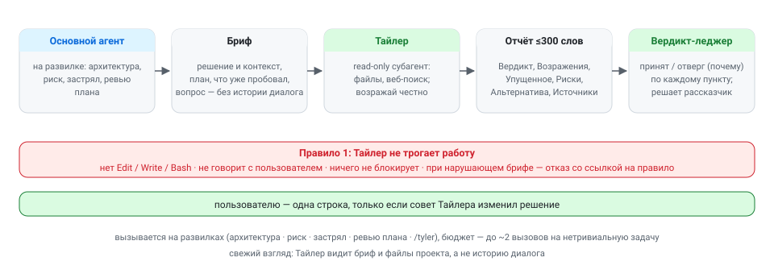

# Tyler Durden


Плагин для ZCode, который даёт основному агенту **второе мнение в каждой сессии**. Тайлер
Дёрден — альтер-эго рассказчика из «Бойцовского клуба»: появляется, когда его вызывают,
говорит жёстко и по существу — и никогда не трогает работу.

> Правило первое: Тайлер не трогает работу.
> Правило второе: ТАЙЛЕР НЕ ТРОГАЕТ РАБОТУ.

<p align="center">
  
</p>

## Как это устроено

- **Тайлер — субагент с read-only инструментами** (`Read, Grep, Glob, WebSearch, WebFetch`).
  У него физически нет чем править файлы, менять состояние и говорить с пользователем —
  невмешательство обеспечено структурой, а не обещаниями. Его единственный канал — отчёт
  основному агенту.
- **Вызывается только на развилках**: выбор архитектуры с настоящими трейд-оффами,
  необратимые действия (удаление данных, `git reset --hard`, миграции), застрял — та же
  ошибка дважды, ревью большого плана. Бюджет — ~2 вызова на задачу; тривиальные случаи
  решаются без него.
- **Свежий взгляд без якорей**: Тайлер видит только компактный бриф (решение, план, что уже
  пробовал, вопрос) и файлы проекта — не историю диалога.
- **Выдуманное несогласие запрещено**: если план хорош — «Согласен» в одну строку. Каждое
  возражение несёт доказательство (файл:строка, док, бенчмарк), иначе отклоняется сразу.
- **Вердиктная бухгалтерия**: основной агент по каждому пункту пишет «принят / отверг
  (почему) / частично» — защита и от слепого следования, и от игнора. Если Тайлер прав —
  агент меняет курс прямо.
- **Один сигнал пользователю**: одна строка, только если совет Тайлера изменил решение.

## Компоненты

- **SessionStart-хук** — компактный протокол в контексте каждой сессии, для любой модели
- **Агент `tyler-durden`** — появляется в списке агентов; вызывается через Agent tool
- **Скилл `tyler-durden`** — полный протокол: когда вызывать, формат брифа, обработка отчёта
- **Команда `/tyler <вопрос>`** — ручной вызов второго мнения

## Установка (ZCode Desktop)

1. **Plugin Marketplace → Add → Add Plugin Marketplace**
2. Вставь адрес репозитория: `https://github.com/artnovaafk/tyler-durden`
3. Установи плагин **Tyler Durden** из появившегося маркета.

<details>
<summary><strong>Про read-only гарантию</strong></summary>

Ограничение инструментов задано во frontmatter агента (`tools: Read, Grep, Glob,
WebSearch, WebFetch`). Если хост не поддерживает ограничение `tools`, read-only остаётся
правилом промпта: правило 1 прямо запрещает правки и исполнения, а при нарушающем брифе
Тайлер обязан отказать в отчёте, сославшись на правило.

</details>

<details>
<summary><strong>Состав репозитория</strong></summary>

```
marketplace.json                                — каталог маркетплейса
tyler-durden/.zcode-plugin/plugin.json          — манифест
tyler-durden/agents/tyler-durden.md             — субагент: роль, правила, формат отчёта
tyler-durden/skills/tyler-durden/SKILL.md       — протокол для основного агента
tyler-durden/hooks/hooks.json                   — SessionStart-хук
tyler-durden/hooks/rules/always.md              — компактные правила для каждой сессии
tyler-durden/commands/tyler.md                  — команда /tyler
```

</details>

## Чего Тайлер не делает

Не правит файлы, не исполняет команды, не разговаривает с пользователем, не блокирует
выполнение, не заменяет тесты и проверки. Он дополнительная пара глаз на развилках, а не
инстанция.

---

## English summary

A ZCode plugin that gives the main agent a second opinion in every session. Tyler Durden —
the narrator's alter ego from Fight Club — is a read-only subagent (`Read, Grep, Glob,
WebSearch, WebFetch`) summoned at decision forks: architecture choices with real trade-offs,
risky or irreversible operations, repeated failures, big plan reviews. He receives a compact
brief (no dialog history — fresh eyes), returns a ≤300-word verdict report with evidence per
objection, and can never touch the work: no edits, no user contact, no blocking. The main
agent keeps a verdict ledger (accepted / rejected / partial) per advice point and mentions
Tyler to the user in one line only when his advice changed a decision. Install: Plugin
Marketplace → Add → paste this repository URL.
